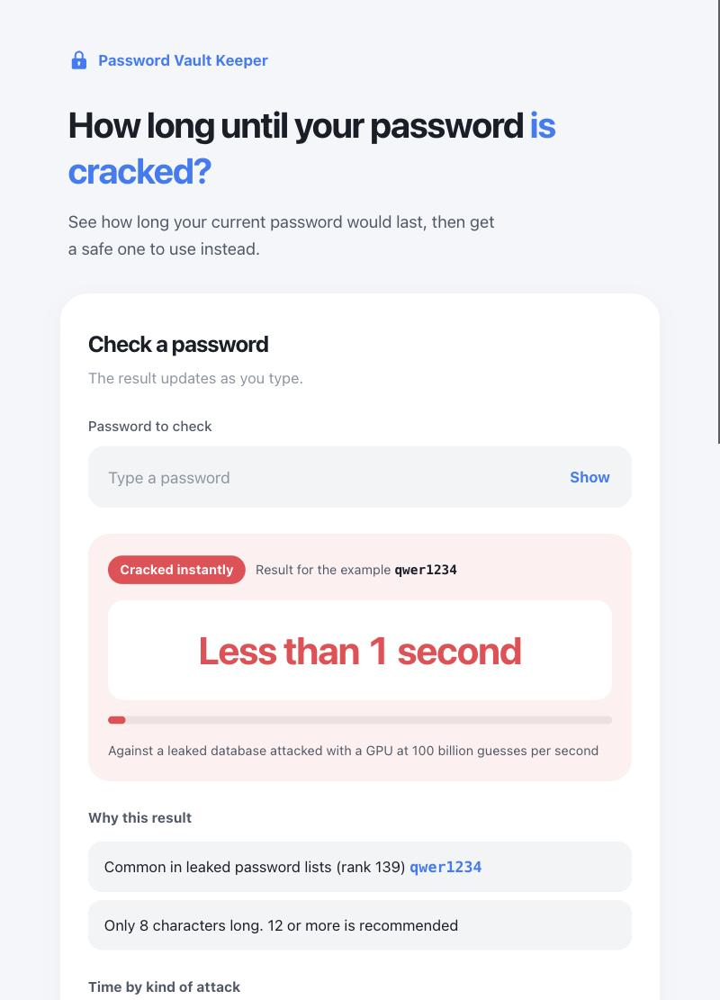
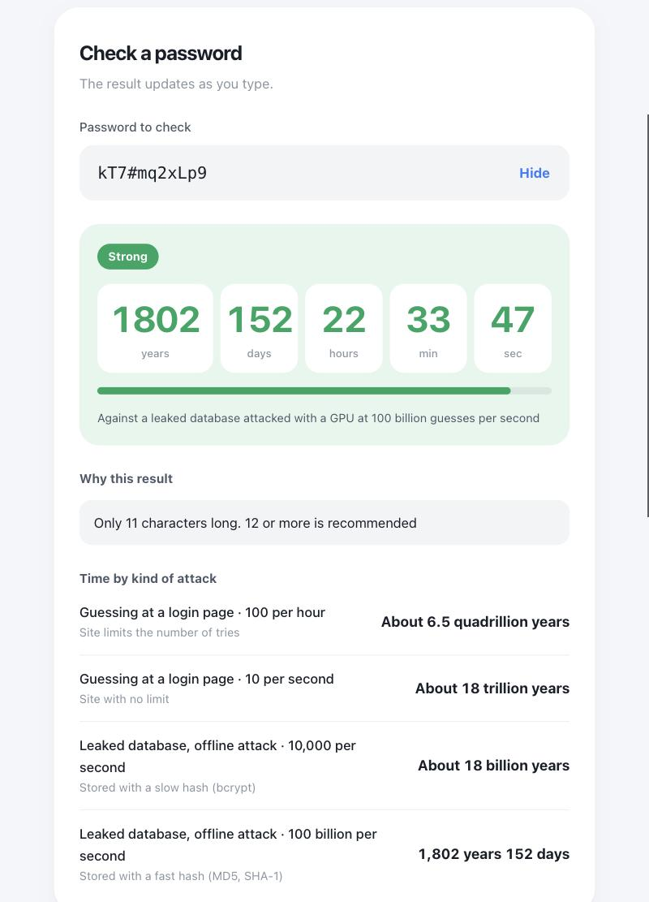
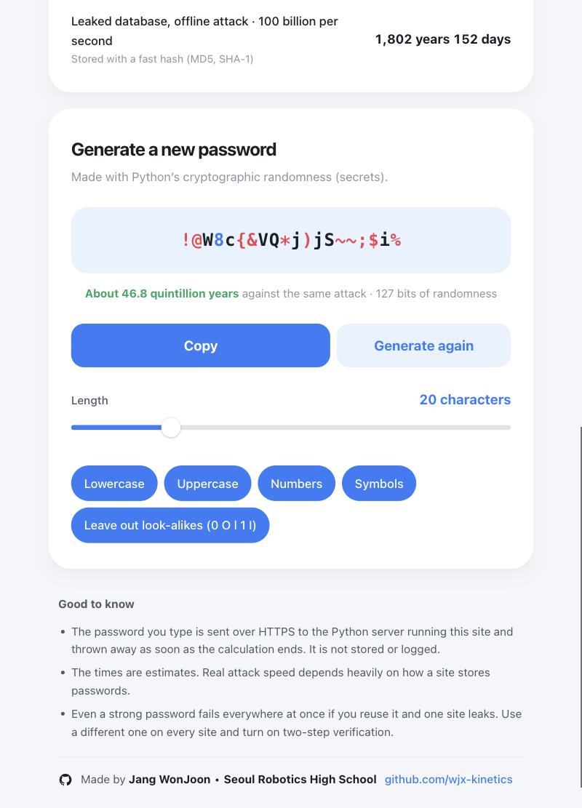

# Password Vault Keeper

[한국어 (Korean repository)](https://github.com/wjx-kinetics/password-site) | **English**

[](https://github.com/wjx-kinetics/password-site-en/actions/workflows/tests.yml)

A website that works out how long your current password would survive an attack, and then makes a safe one you can use instead. It is built with Python (Flask) and served over HTTPS.

| Weak password | Strong password | Generating a password |
|---|---|---|
|  |  |  |

## Presentation

- [Presentation slides (PDF)](docs/presentation-en.pdf)
- The Korean version is in the [Korean repository](https://github.com/wjx-kinetics/password-site).

## Why we made it

Password leaks keep happening, but it is hard to feel how weak your own password really is. A password such as `qwer1234!` follows the usual rule of "8 or more characters with a symbol" and is still cracked in under a second. This site turns that fact into a time you can read: years, days, hours, minutes and seconds.

## Features

**Checking a password**
- Shows the time to crack it as you type, in years, days, hours, minutes and seconds.
- Explains why it is weak: a leaked password, a keyboard pattern, a date, a repeat, a dictionary word, and so on.
- Catches Korean habits too. For example it recognizes `dkssud` (안녕, "hello") and `tkfkdgo` (사랑해, "I love you"), which are Korean words typed with the keyboard left in English mode.
- Shows the time for four different kinds of attack.

**Generating a password**
- Length from 8 to 64 characters, with your choice of lowercase, uppercase, numbers and symbols.
- Can leave out look-alike characters such as `0` and `O`, or `l` and `1`.
- Shows how long the new password would last against the same attack.

## How to run it

You need Python 3.9 or later. If you do not have it, install it from [python.org](https://www.python.org/downloads/). On Windows, tick **Add python.exe to PATH** on the first screen of the installer.

### 1. Download

Press the green **Code** button at the top of this page, choose **Download ZIP**, and unzip it. If you use git:

```
git clone https://github.com/wjx-kinetics/password-site-en.git
```

### 2. Run

**Windows**: double-click `run.bat` in the folder.

**macOS / Linux**: open Terminal, go to the folder, and run:

```
sh run.sh
```

The first run takes about a minute because it installs the packages it needs. When it is ready, your browser opens `https://localhost:8443` automatically.

### 3. Get past the browser warning

The site uses a certificate it creates itself (a self-signed certificate), so the browser shows a warning such as "Your connection is not private" the first time. Choose **Advanced → Proceed to localhost (unsafe)**. The connection is still encrypted.

### Stopping it

Press `Ctrl + C` in the terminal window where it is running, or close that window.

### Options

| Command | What it does |
|---|---|
| `run.bat --lan` / `sh run.sh --lan` | Lets phones and other computers on the same Wi-Fi connect. |
| `--port 9000` | Uses another port instead of 8443. |
| `--no-browser` | Does not open the browser automatically. |

### Running it without the scripts

```
python -m venv .venv
.venv\Scripts\pip install -r requirements.txt      (Windows)
.venv/bin/pip install -r requirements.txt          (macOS / Linux)
.venv\Scripts\python app.py                        (Windows)
.venv/bin/python app.py                            (macOS / Linux)
```

## How it works

### How the crack time is calculated

```
time = guesses the attacker needs ÷ guesses per second
```

**Estimating the guesses**

Attackers do not try every combination from the start. They begin with what people use most: leaked passwords, dictionary words, keyboard patterns and dates. Counting only the length and the kinds of characters makes a password look far stronger than it is.

This site uses `zxcvbn`, an algorithm made by Dropbox, to split the password into pieces and estimate how early an attacker would try each one.

| Pattern it finds | Examples |
|---|---|
| Leaked passwords | `password`, `qwer1234` |
| Dictionary words, common names | `summer`, `michael` |
| Character swaps | `P@ssw0rd` |
| Keyboard patterns | `qwerty`, `1q2w3e4r` |
| Sequences and repeats | `abcd`, `1234`, `aaaa` |
| Dates and years | `2024`, `19990101` |
| Korean words (added by us) | `dkssud`, `안녕하세요` |

A random piece that matches no pattern counts as `character types ^ length`. The character types are 26 for lowercase, 26 for uppercase, 10 for digits, 33 for symbols and 2350 for Korean letters, adding only the kinds that appear.

**Guesses per second**

The same password lasts very differently depending on the attack. The large clock on the site uses the last row, the worst case.

| Attack | Speed |
|---|---|
| Guessing at a login page (rate-limited) | 100 per hour |
| Guessing at a login page (no limit) | 10 per second |
| Leaked database, slow hash (bcrypt) | 10,000 per second |
| Leaked database, fast hash (MD5, SHA-1) | 100 billion per second |

**Verdicts** (at 100 billion guesses per second)

| Time to crack | Verdict |
|---|---|
| Under 1 minute | Cracked instantly |
| Under 1 day | Very weak |
| Under 1 year | Weak |
| Under 100 years | Fair |
| 100 years or more | Strong |

### How a password is generated

It uses the `secrets` module from the Python standard library. Ordinary random numbers (`random`) can be predicted, so they must not be used for passwords. `secrets` uses cryptographic randomness from the operating system. To make sure each chosen kind of character appears at least once, the password is drawn again until it does.

Randomness is shown as `length × log2(character types)` bits. The default setting (20 characters from 81 types) is about 127 bits.

### Structure

```
Browser (static/)                      Python server (app.py)
┌──────────────────────┐   HTTPS    ┌─────────────────────────────┐
│ Input box and clock  │ ─────────> │ /api/check     check a password │
│ Only draws results   │ <───────── │ /api/generate  make a password  │
└──────────────────────┘    JSON    └─────────────────────────────┘
```

The Python server does all the calculation. The JavaScript in the browser only draws the results it receives.

### What we did for security

- **HTTPS**: the certificate is created automatically on the first run and kept in the `certs/` folder. Passwords are never sent unencrypted.
- **Nothing is stored**: a password is used only for the calculation and is not written to any file or log.
- **No outside requests**: no fonts or scripts are loaded from other servers. A security header (CSP) also blocks outside code.
- **Rate limit**: one person is blocked for a while after more than 150 requests in 10 seconds.
- **Local only by default**: other devices cannot connect unless you add the `--lan` option.

## Checked against real data

To see whether the site's verdicts match reality, we looked up our example passwords in [Pwned Passwords](https://haveibeenpwned.com/Passwords), a public collection of passwords from real data breaches. The lookup uses its range API, which receives only the first 5 characters of a hash. Counts are as of 26 November 2026.

| Password | Times seen in real breaches | Verdict on this site |
|---|---|---|
| `password` | 52,373,976 | Cracked instantly |
| `P@ssw0rd` | 6,421,554 | Cracked instantly |
| `qwer1234` | 3,436,774 | Cracked instantly |
| `qwer1234!` | 48,084 | Cracked instantly |
| `tkfkdgo` (사랑해, "I love you") | 174,486 | Cracked instantly |
| `dkssud` (안녕, "hello") | 24,239 | Cracked instantly |
| `qlalfqjsgh` (비밀번호, "password") | 15,976 | Cracked instantly |
| `dkssud12!` | 3,824 | Cracked instantly |
| `kT7#mq2xLp` (random, 10 characters) | 0 | Fair |
| `kT7#mq2xLp9` (random, 11 characters) | 0 | Strong |
| `hG7#kq9!Zp2x` (random, 12 characters) | 0 | Strong |

What this shows:

- `qwer1234!` passes the usual rules (8 or more characters, a number, a symbol) and has still been leaked more than 48,000 times.
- Korean words typed on an English keyboard appear tens of thousands of times. The Korean word list we added covers a real habit, not a guess.
- The random passwords do not appear at all.

## How we chose the attack speed

The first version used 10 billion guesses per second for a fast hash, the figure `zxcvbn` assumes. We checked that figure against speeds published by people who crack passwords professionally, measured with hashcat, the standard tool for this work.

| Published measurement | MD5 | SHA-1 |
|---|---|---|
| 25-GPU cluster shown by Jeremi Gosney at the Passwords^12 conference (2012) | 180 billion/s | 63 billion/s |
| One RTX 3090, hashcat benchmark (2020) | 65.1 billion/s | 22.8 billion/s |
| One RTX 4090, hashcat benchmark (2022) | 164.1 billion/s | 50.6 billion/s |
| One RTX 5090, hashcat benchmark (2025) | 220.6 billion/s | 70.2 billion/s |
| **Average** | **157.4 billion/s** | **51.7 billion/s** |

The average of all eight figures is 104.6 billion guesses per second. The site now uses **100 billion per second**. The old value was about ten times too low.

What changed:

- Weak passwords are not affected. They were already cracked instantly.
- `kT7#mq2xLp` (10 random characters) went from 189 years, rated Strong, to 19 years, rated Fair.
- One more random character (`kT7#mq2xLp9`) brings it back to 1,802 years. This is the clearest example we have that length matters most.

What this number does not cover:

- Three of the four measurements are a single graphics card. An attacker with ten cards is ten times faster.
- Some hashes are faster still. NTLM, used by Windows, runs at 340 billion per second on one RTX 5090.
- Slow hashes are far slower. bcrypt runs at 184,000 per second on an RTX 4090 at 32 iterations, which is about 5,750 per second at a more realistic 1,024 iterations (our calculation). The site's "slow hash" row uses 10,000 per second.

## Tests

The checking, time and generating functions and the two API addresses are covered by 52 automated tests in `tests/test_app.py`. They run on every push on Windows, macOS and Linux, with Python versions from 3.9 to 3.12.

```
pip install -r requirements-dev.txt
pytest
```

What the tests check:

- Common passwords (`password`, `qwer1234!`, `P@ssw0rd`) are cracked in under a minute.
- Korean words typed on an English keyboard (`dkssud`, `tkfkdgo`) are recognized as Korean words.
- A random password is rated strong, and a longer random password always takes longer.
- The verdict changes exactly at 1 minute, 1 day, 1 year and 100 years.
- A generated password has the requested length, contains every chosen kind of character, and never contains a look-alike character when that option is on.
- The server never sends a strong password back in its reply, limits the length to 8–64, and blocks a client after 150 requests in 10 seconds.

## Files

| File | Role |
|---|---|
| `app.py` | The Python server: checking, time calculation, password generation, HTTPS certificate |
| `static/index.html` | Page layout and text |
| `static/style.css` | Colors and shapes |
| `static/app.js` | Sends requests to the server and shows the results |
| `requirements.txt` | The Python packages it needs |
| `tests/test_app.py` | Automated tests (run with `pytest`) |
| `requirements-dev.txt` | Packages needed to run the tests |
| `.github/workflows/tests.yml` | Runs the tests automatically on GitHub |
| `run.bat`, `run.sh` | Start scripts for Windows and for macOS / Linux |

## Built with

- Python 3, Flask (web server)
- zxcvbn (password pattern analysis)
- cryptography (HTTPS certificate)
- HTML, CSS, JavaScript (the page)

## Things to know

- The times are estimates. Real attack speed depends on how a site stores passwords and on the attacker's hardware.
- When you run it on your own computer, your password never leaves that computer. If you open an address run by someone else, do not type a password you really use. Try an example of a similar shape instead.

## Development notes

Problems we ran into, and how we solved them.

**1. Random passwords were rated far too weak**

- Problem: `zxcvbn` on its own rates a 20-character random password at about 32 years, far less than its real strength.
- Cause: `zxcvbn` counts each character of a random part as 10 possibilities, whatever characters are used. A password drawn from 81 different characters was treated as if it were made of digits.
- Fix: for random parts we now use `character types ^ length` with the real number of character types, and keep the `zxcvbn` estimate for words and patterns. The same password is now shown as about 46.8 quintillion years. A test (`test_random_part_uses_real_character_count`) keeps this from breaking again.

**2. Korean passwords were rated too strong**

- Problem: `dkssud12!` was given 41 days, although `dkssud` is the Korean word 안녕 ("hello") typed with the keyboard in English mode. This is a very common way to make a password in Korea.
- Cause: the word lists in `zxcvbn` are English, so `dkssud` was counted as six random letters.
- Fix: we added a list of common Korean words, both in Korean letters and as typed on an English keyboard, and pass it to `zxcvbn` as extra dictionary words. `dkssud12!` is now cracked in under a second.

**3. HTTPS without asking the user to make a certificate**

- Problem: a password site should not send passwords unencrypted, but making a certificate by hand is hard, and the usual tool (`openssl`) is not installed on Windows.
- Fix: on the first run, Python creates a self-signed certificate itself with the `cryptography` library and stores it in `certs/`. The same code works on Windows, macOS and Linux. The private key is kept out of the repository with `.gitignore`.

**4. From browser-only to a Python server**

- The first version did every calculation in the browser. When we moved the calculation to Python, the password had to travel to the server, which is a real cost for a tool like this.
- To limit that cost the server only listens on the local computer by default, stores and logs nothing, loads nothing from other sites, and limits the request rate. The README also tells visitors not to type a real password into a copy run by someone else.

**5. The attack speed was ten times too low**

- Problem: when we compared the site with published hashcat benchmarks, one modern graphics card turned out to be faster than the 10 billion guesses per second we had taken from `zxcvbn`.
- Fix: we collected eight published measurements, averaged them, and changed the speed to 100 billion per second. One of our own "strong" examples dropped to Fair, so we replaced it in the screenshots and slides instead of keeping the better-looking number.

## Limitations and next steps

**Limitations**

- The times are estimates, not measurements. The fastest attack speed we use (100 billion guesses per second) is an average of published speeds, mostly for a single graphics card. A real attacker may have many cards (see "How we chose the attack speed").
- The site itself does not check real breach data. It only knows the lists built into `zxcvbn` (about 30,000 common passwords). We compared a few examples by hand, but a visitor's password is not looked up.
- The Korean word list is small (28 entries). A Korean word that is not on the list is still treated as random letters.
- Counting 2,350 possibilities for a Korean character is a rough figure.
- `zxcvbn` reads at most 72 characters, so the rest of a longer password is treated as random.
- The certificate is self-signed, so the browser shows a warning, and the server is the Flask development server. Both are fine on your own computer but not for a public service.
- The rate limit is kept in memory, so it resets when the server restarts.

**Next steps**

- Check passwords against real breach data with the Have I Been Pwned range API, which only sends the first 5 characters of a hash.
- Convert any Korean word to its English-keyboard form automatically, instead of keeping a fixed list.
- Add a passphrase generator (several random words), which is easier to remember.
- Do the checking in the browser again when the site is public, so a visitor's password never leaves their device.
- Deploy with a production server and a real certificate.

## What this project taught us

- Password rules and password strength are different things. A password can pass every rule and still be among the first an attacker tries.
- Length matters more than anything else. Each extra random character multiplies the work by the number of character types.
- Random numbers for security must come from a cryptographic source (`secrets`), not from `random`.
- A library's result should be checked, not just trusted. We only found the problem with random passwords because we tested a password whose real strength we could work out by hand.

## References

- Daniel Lowe Wheeler, "zxcvbn: Low-Budget Password Strength Estimation", USENIX Security 2016. https://www.usenix.org/conference/usenixsecurity16/technical-sessions/presentation/wheeler
- zxcvbn (Dropbox), including the four attack speeds used on this site. https://github.com/dropbox/zxcvbn
- zxcvbn-python, the Python version used here. https://github.com/dwolfhub/zxcvbn-python
- Python `secrets` module documentation. https://docs.python.org/3/library/secrets.html
- NIST Special Publication 800-63B, Digital Identity Guidelines (password length over composition rules). https://pages.nist.gov/800-63-3/sp800-63b.html
- Flask documentation. https://flask.palletsprojects.com/
- Have I Been Pwned, Pwned Passwords and its range API (source of the breach counts above). https://haveibeenpwned.com/Passwords
- Chick3nman, hashcat benchmarks for the RTX 3090, RTX 4090 and RTX 5090 (source of the single-card speeds above). https://gist.github.com/Chick3nman/e4fcee00cb6d82874dace72106d73fef · https://gist.github.com/Chick3nman/32e662a5bb63bc4f51b847bb422222fd · https://gist.github.com/Chick3nman/09bac0775e6393468c2925c1e1363d5c
- Infosecurity Magazine, "GPU cluster can crack any NTLM 8-character hashed password in 5.5 hours" (source of the 2012 cluster speeds). https://www.infosecurity-magazine.com/news/gpu-cluster-can-crack-any-ntlm-8-character-hashed
- Hive Systems, "Are Your Passwords in the Green?", a yearly table of password cracking times. It assumes bcrypt and random passwords, so its numbers are not directly comparable with ours. https://www.hivesystems.com/blog/are-your-passwords-in-the-green-2025
- Chae et al., "The Threat of Password Guessing Attacks Exploiting Linguistic Characteristics: A Case Study on the Korean Domains" (related research on Korean passwords). https://pure.korea.ac.kr/en/publications/the-threat-of-password-guessing-attacks-exploiting-linguistic-cha/

<!--
Sections to write yourself before using this as a portfolio (they are hidden on GitHub until you remove these comment marks):

## My role
- What I built myself:
- What I decided, and why:
- What was hardest for me:

## Tools
- State here how AI tools were used, following the rules of the school or company you apply to.
-->

## Made by

Jang WonJoon ∙ Seoul Robotics High School · [github.com/wjx-kinetics](https://github.com/wjx-kinetics)
